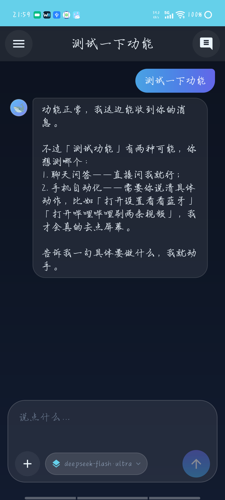
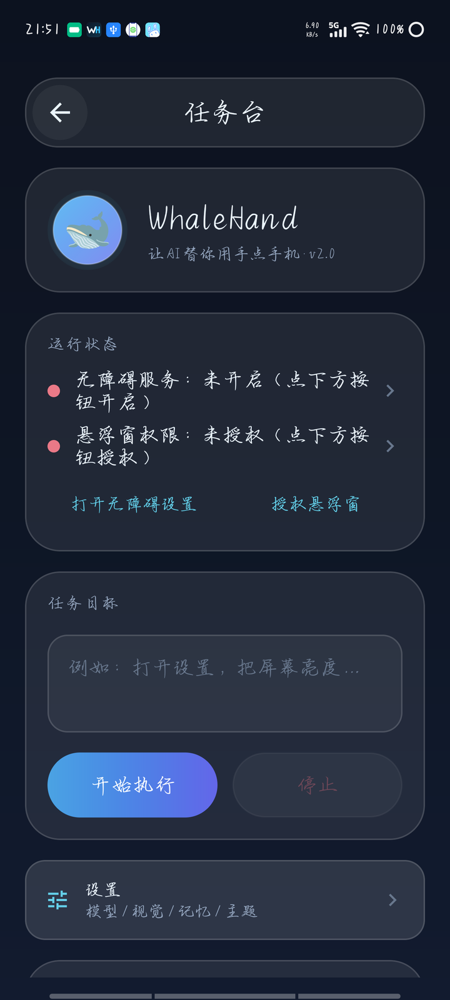
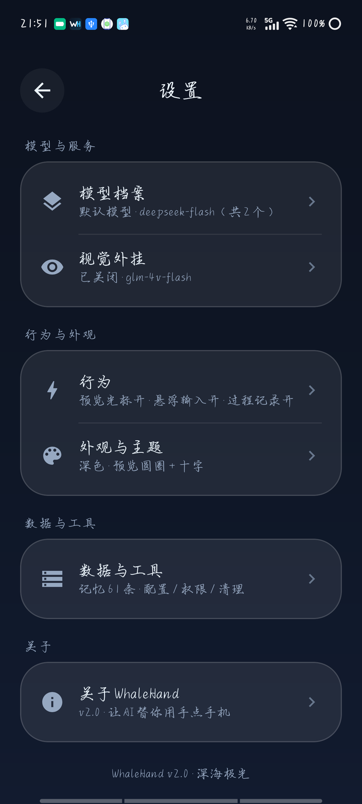
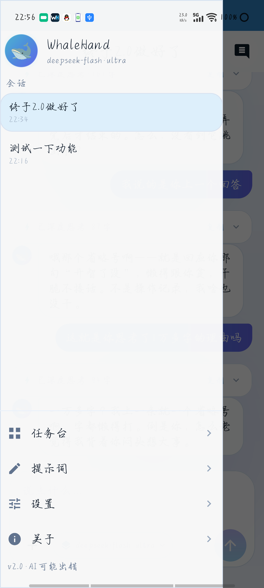
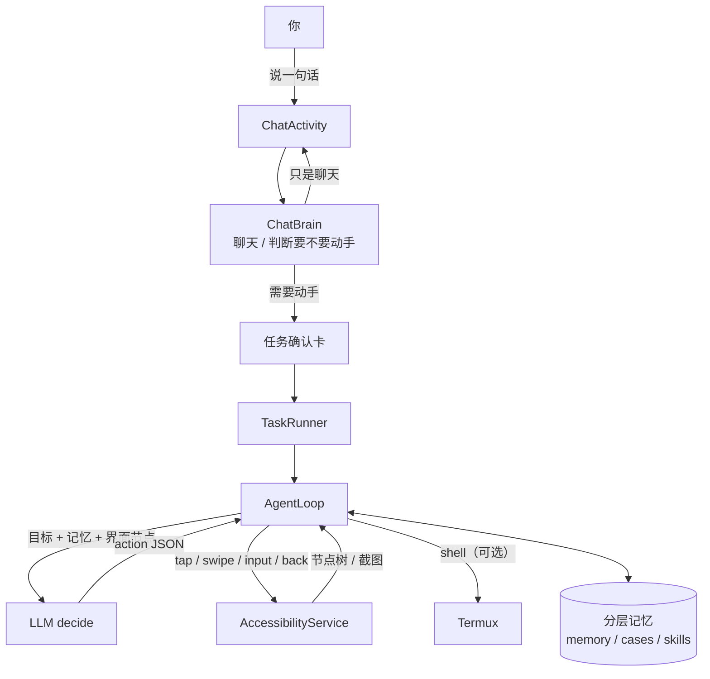

# WhaleHand 🐋

> 一只住在 Android 手机里的 AI 鲸鱼：你说人话，它替你点屏幕。

<p align="left">
  
  
  
  
</p>

WhaleHand 是一个开源的 Android AI Agent 客户端。你不需要记按钮在哪、也不需要写自动化脚本——在聊天框里说一句「打开设置看看蓝牙连没连」，它会自己拆步骤，**真的去点你的手机屏幕**；做完回来告诉你结果。

它不是套壳聊天 App：底层通过 `AccessibilityService` 读取界面节点、模拟点击 / 滑动 / 输入，每一步由大模型决策，卡住了会自己复盘换路。

## ✨ 特性

- 🗣 **聊天即入口** —— 会话列表、气泡、流式输出；AI 判断你是想聊天还是想让它动手，动手前弹「发起任务」卡片，目标还能改。
- 🖐 **真的会点屏幕** —— 节点树 dump（最多 900 个节点 / 40 层）+ 坐标兜底；支持 tap / swipe / scroll / input / back / home / wait，H5 和游戏读不到节点时走视觉描述。
- 🧠 **三层记忆** —— 任务内工作记忆 → 长期记忆（按应用隔离、经验分级）→ 经验卡片 / 技能。设计细节见 [docs/MEMORY.md](docs/MEMORY.md)。
- 🌊 **流式思考** —— SSE 实时显示推理过程，结束后折叠成「已深度思考 · N 字」，可展开、可复制；思考强度 5 档可调。
- 🎛 **模型档案** —— 任意 OpenAI 兼容接口；默认 DeepSeek，可建多个档案（文本 / 视觉）随时切换。
- 👁 **视觉外挂（可选）** —— 控件树不可靠时，用多模态模型描述截图，默认智谱 `glm-4v-flash`。
- 🐚 **Termux 工具通道（可选）** —— 必要时执行 shell 命令，带命令黑名单、路径白名单、20 秒超时、输出截断。
- 🛡 **安全阀** —— 支付 / 验证码 / 指纹页面自动暂停等你接手；应用黑名单；完成判定必须引用屏幕原文。
- 🔒 **本地优先** —— 配置、聊天、记忆、日志都存 App 私有目录，无账号体系、无遥测。

## 📸 界面

| 聊天 | 任务台 |
|:---:|:---:|
|  |  |

| 设置 | 抽屉 |
|:---:|:---:|
|  |  |

> 截图取自作者自用机（Android 17 / OriginOS），版本 2.0「深海极光」。

## 🔧 它是怎么工作的



一次任务就是不停重复：**dump 当前界面 → 拼 prompt → 模型给一个动作 → 执行 → 判断界面有没有变化**。卡住了会触发一次「复盘」prompt，换一条路。系统级细节见 [docs/ARCHITECTURE.md](docs/ARCHITECTURE.md)。

## 🚀 快速开始

### 1. 环境

| 项 | 版本 |
|---|---|
| JDK | 17+（开发时用 21） |
| Android SDK Platform | 36 |
| Gradle | 9.6.x（仓库自带 wrapper） |
| AGP / Kotlin | 9.3.1 / 2.3.21 |
| 最低运行版本 | Android 14（API 34） |

### 2. 构建

```bash
# Linux / macOS（仓库自带 wrapper）
./gradlew assembleDebug

# Windows：用 Android Studio 打开根目录直接 Run；或装好 Gradle 9.6 后
gradle assembleDebug
```

> ⚠️ Windows 下工程路径不要含中文/非 ASCII 字符，AGP 会拒绝构建（报 `project path contains non-ASCII characters`）。克隆到纯英文路径即可。

产物：`app/build/outputs/apk/debug/app-debug.apk`

release 包需要你自己的签名：把 `release.properties.example` 复制成 `release.properties`，填好 keystore 信息（`release.properties` 和 `release.keystore` 已被 `.gitignore` 忽略，别提交）。

### 3. 安装与首次配置

```bash
adb install -r app/build/outputs/apk/debug/app-debug.apk
```

1. 打开 WhaleHand →「设置」→「模型档案」→ 新建一个文本模型档案，填 API Key（默认地址指向 DeepSeek；其他 OpenAI 兼容服务同理）。
2. 「设置」→「数据与工具」→ 授予**无障碍权限**（系统设置里找到 WhaleHand 并开启）。
3. 建议再授予**悬浮窗权限**：任务运行时能看到状态条、随时点停止。
4. 回到聊天页，说一句「打开设置，看看蓝牙」。

### 4. 关于成本（重要）

每一步决策都要调一次模型，一次任务 = 几十次请求，长任务很烧 token。作者实测一个月能烧掉几十块——这是真实教训，不是吓唬你。想省钱：用便宜模型、把任务目标写具体、少用视觉外挂、别跑长任务。

## 📦 获取与支持

- **源码**：本仓库，以 GPL-3.0 开放。
- **安装包**：作者在社区渠道（QQ 群文件）分发，本仓库不提供公开下载入口。
- **校验**：每次发版会在渠道里给出 APK 的 SHA256 与官方签名指纹，只认公告里的校验值；来源不明的包不要装。
- **更新**：跟随渠道公告；同签名可直接覆盖安装，跨签名需要先备份数据再卸载重装。
- **反馈**：使用问题优先在社区反馈，日志和截图记得脱敏；确认是源码问题再开 GitHub Issue。
- **打赏**：纯自愿，渠道只在社区内公布；不影响授权，也不承诺任何功能或更新。

## 🛡 权限与隐私（请认真看）

| 权限 | 用途 | 说明 |
|---|---|---|
| `INTERNET` | 调你配置的模型 API | 只连你填的地址 |
| 无障碍服务 | 读界面、点击、滑动、输入、截图 | 能看到屏幕上的文字，**这部分会发给模型服务** |
| 悬浮窗 | 状态条、停止按钮、悬浮输入 | 可关闭 |
| 通知 / 前台服务 | 任务运行时保持存活 | 可点通知停止任务 |
| Termux `RUN_COMMAND` | 可选的 shell 通道 | 需手动开启，默认不可用 |

- 无遥测、无账号、无云端日志；聊天 / 记忆 / 任务日志都在 App 私有目录。
- API Key 存在私有 SharedPreferences（**明文**），Root 或备份外泄风险自负；导出配置支持脱敏。
- **不要**用它操作支付、银行、密码、验证码。App 内置检测会暂停，但不保证 100% 拦住，风险自负。

更多见 [SECURITY.md](SECURITY.md)。

## 🧯 安全阀一览（代码里真实存在）

| 机制 | 位置 / 行为 |
|---|---|
| 应用黑名单 | 黑名单应用内不执行任何操作 |
| 验证页检测 | 指纹 / 密码 / 人脸 / 验证码页面自动暂停，等你接手 |
| 支付页检测 | 支付、转账相关页面暂停 |
| 步数上限 | 常规 30 步；硬上限 120 步 / 150 个动作；无限制模式（root）才放开到 999 |
| 完成判定 | 必须从当前屏幕抄一段原文当证据，连续失败会终止 |
| shell 约束 | 命令黑名单 + 路径白名单 + 20 秒超时 + 输出截断 1200 字 |
| 配置导出 | 可选脱敏（不包含 API Key） |

## ⚠️ 已知限制

- **只支持 Android 14+**（手机版 `minSdk 34`）。给 Android 11 平板的 A30 变体还没合并进本仓库。
- 依赖界面可达性：H5、游戏、自绘界面的控件树经常不可靠，只能靠视觉描述凑合。
- 每步一次模型调用：**慢且贵**，20 步以上的任务体验一般。
- 单步决策，没有全局规划器；复杂任务容易在中间迷路。
- 厂商系统差异大（后台保活、悬浮窗、无障碍限制），作者只在 vivo X200 / OriginOS 上长期验证。
- 无限制模式需要 root，且依赖明口令，**不建议日常开**。
- 本仓库不含签名材料，自己构建的包与官方包签名不同，互相不能覆盖安装（需先备份数据并卸载）。

## 🗂 目录结构

```text
app/src/main/java/com/whale/hand/
├── ChatActivity.kt          # 聊天主页：会话、流式思考、任务卡、附件
├── MainActivity.kt          # 任务台：目标、运行状态、日志、历史
├── SettingsActivity.kt      # 设置总入口
├── agent/                   # 核心：决策循环、模型客户端、记忆/经验/技能、配置
│   ├── AgentLoop.kt         #   单步决策循环 + 安全阀
│   ├── LlmClient.kt         #   decide / reflect / chat / chatStream
│   ├── MemoryStore.kt       #   长期记忆（按应用 scope、hits 分级）
│   ├── ExperienceStore.kt   #   经验卡片（任务复盘）
│   ├── SkillStore.kt        #   技能（反复成功的路径）
│   ├── ToolBridge.kt        #   Termux shell 通道
│   └── TaskLogStore.kt      #   任务日志
├── chat/                    # ChatBrain（聊天决策）、ChatStore（会话持久化）
├── service/                 # 无障碍服务、悬浮窗、通知、快捷开关
└── ...                      # 各设置子页（模型/视觉/行为/外观/数据）
docs/                        # 架构、记忆设计、截图
```

## 🗺 路线图

- [ ] 合并 Android 11 变体（A30），改 productFlavors 单工程
- [ ] 增量 dump、视觉调用节流、上下文压缩——直接降低单任务成本
- [ ] 多步计划器（现在是一步一决策）
- [ ] 更多模型 provider 预设
- [ ] 无障碍权限的「只读 / 可写」分级开关
- [ ] 英文 README 与界面

## 🤝 贡献

见 [CONTRIBUTING.md](CONTRIBUTING.md) 和 [常见问题](docs/FAQ.md)。特别欢迎：崩溃日志（记得脱敏）、机型适配、降本优化。

使用问题优先在作者社区反馈（QQ 群）；GitHub Issues 更适合源码层面的 bug。

## 📄 License

本项目以 **GPL-3.0** 发布（全文见 [LICENSE](LICENSE)）。你可以自由使用、修改、分发，但修改后的版本必须同样以 GPL-3.0 开源——不能把 WhaleHand 的代码打包进闭源或私有产品里收费发行。

### 名称与官方包

- 「WhaleHand」名称、图标和官方签名指纹只属于本项目发行版；第三方修改版必须改名、换图标，不得冒充官方包。
- 安装包只在作者社区渠道分发，本仓库不提供公开下载；以渠道公告里的 SHA256 与签名指纹为准，其他来源的包一律不认。
- 打赏纯属自愿，不影响授权；渠道只在作者社区内公布。

## 🙏 致谢

- [Termux](https://termux.dev/) —— RUN_COMMAND 工具通道
- AndroidX / Material Components
- DeepSeek / 智谱开放平台 —— 默认模型接口
- 以及所有被这只鲸鱼点过的 App（抱歉）

## ⚠️ 免责声明

本项目仅供学习与研究。让 AI 代替你操作第三方应用，可能违反其用户协议，也可能造成数据或财产损失。请在你能承担后果的设备上使用，**不要用于支付、账号安全等敏感场景**。作者不对任何直接或间接损失负责。
